<div align="center">

<picture>
  <source media="(prefers-color-scheme: dark)" srcset="./assets/header-dark.svg" />
  
</picture>

<a href="https://arielbogado.vercel.app"></a>
<a href="https://www.linkedin.com/in/arielbogadogimenez"></a>
<a href="mailto:arielbogadogimenez@gmail.com"></a>

</div>

<br />

Mi portafolio es una API, y este perfil también. Esta es la respuesta real de `GET /api/v1/es/perfil.json`:

```http
GET /api/v1/es/perfil.json HTTP/1.1
Host: arielbogado.vercel.app
Accept: application/json
```

```json
{
  "nombre": "Ariel Bogado",
  "rol": "Backend Developer",
  "ubicacion": "Paraguay",
  "perfil": [
    "Backend Developer | C# · .NET",
    "APIs REST · PostgreSQL · SQL Server",
    "Frontend con React + Tailwind",
    "Estudiante de Ingeniería Informática"
  ],
  "intereses": [
    "IA aplicada",
    "Sistemas distribuidos"
  ]
}
```

<details open>
<summary> <b><code>/sobre-mi</code></b> · Sobre mí</summary>
<br />

Desarrollador backend con más de 2 años de experiencia en C# y .NET, enfocado en el desarrollo y mantenimiento de sistemas en producción para la gestión universitaria. Experiencia en bases de datos PostgreSQL y SQL Server, APIs REST, relevamiento de requerimientos y coordinación de equipos de desarrollo, además de desarrollo frontend con React, Tailwind CSS y Bootstrap. Estudiante de 5.º año de Ingeniería Informática, con interés en IA aplicada y sistemas distribuidos.

-  **Software Developer en UNIDA**: desarrollo y mantengo la plataforma universitaria en .NET, relevo requerimientos con las áreas usuarias y lidero al equipo de desarrollo
-  Proyectos **freelance**: sistemas de gestión, punto de venta e inventario
-  Estudiante de 5.º año de **Ingeniería Informática**
-  Me interesan la **IA aplicada** y los **sistemas distribuidos**
-  Paraguay

</details>

<details open>
<summary> <b><code>/stack</code></b> · Stack tecnológico</summary>
<br />

<table>
  <tr>
    <td align="center"><b>Frontend</b></td>
    <td></td>
  </tr>
  <tr>
    <td align="center"><b>Backend</b></td>
    <td></td>
  </tr>
  <tr>
    <td align="center"><b>Bases de datos</b></td>
    <td>
      
      
      
    </td>
  </tr>
  <tr>
    <td align="center"><b>Herramientas</b></td>
    <td></td>
  </tr>
</table>

</details>

<details open>
<summary> <b><code>/experiencia</code></b> · Experiencia</summary>
<br />

**Software Developer** · Universidad de la Integración de las Américas (UNIDA)<br />
<sub><code>2024-04 → presente</code></sub>

**Desarrollo**

- Desarrollo nuevas funcionalidades y realizo el mantenimiento de la plataforma universitaria en C# con ASP.NET MVC y ASP.NET Core (.NET 10).
- Construyo módulos y APIs REST a medida para distintas áreas de la universidad, desde el modelado de datos hasta la integración con otros sistemas.
- Modelo bases de datos en SQL Server y optimizo el acceso a datos mediante consultas SQL y LINQ.
- Diagnostico y corrijo incidencias en producción, y automatizo procesos internos para reducir tareas manuales.

**Liderazgo y análisis**

- Relevo requerimientos con las distintas áreas de la universidad, los analizo y defino el alcance de cada desarrollo.
- Planifico y distribuyo las tareas del equipo de desarrollo según prioridades, bajo la supervisión de la Jefatura de Sistemas.
- Reviso el trabajo entregado por el equipo y hago seguimiento del cumplimiento de plazos.
- Valido las entregas con los usuarios y elaboro documentación técnica de los sistemas.

</details>

<details open>
<summary> <b><code>/proyectos</code></b> · Proyectos</summary>
<br />

<table>
<tr>
<td colspan="2">

###  Cyclo — Plataforma de economía circular
<sub><code>GET /proyectos/cyclo</code> · <b>Rol:</b> Desarrollador full stack · Líder técnico</sub>

App ciudadana de reciclaje con mapa interactivo, reconocimiento de materiales por cámara (CycloScan) y gamificación con validación por geolocalización. Disponible en español, inglés y coreano. Lideré el desarrollo en el **Global Green Challenge**, junto a INHA University (Corea del Sur).


[](https://cyclo-nine.vercel.app)
[](https://github.com/ArielBG1/Cyclo)

</td>
</tr>
<tr>
<td width="50%" valign="top">

###  DespensaAPP — POS e inventario
<sub><code>GET /proyectos/despensa-app</code></sub>

Punto de venta e inventario para comercio minorista: lector de código de barras, productos por peso, compras, auditoría de stock y roles.


[](https://github.com/ArielBG1/DespensaAPP)

</td>
<td width="50%" valign="top">

###  Asistencia con reconocimiento facial
<sub><code>GET /proyectos/facial-attendance</code></sub>

Marcación docente que valida ventana horaria, proximidad GPS (100 m) e identidad facial con anti-spoofing usando DeepFace y SQL Server.


[](https://github.com/ArielBG1/sistema_marcacion_docente)

</td>
</tr>
<tr>
<td width="50%" valign="top">

###  Soporte por tickets
<sub><code>GET /proyectos/ticket-support</code> · Proyecto en equipo</sub>

Sistema de mesa de ayuda para registrar y dar seguimiento a tickets de soporte.


[](https://github.com/ArielBG1/soporte_ticket)

</td>
<td width="50%" valign="top">

###  Torotech — Landing Page
<sub><code>GET /proyectos/torotech-landing</code></sub>

Landing page para Torotech, la plataforma educativa del Instituto Técnico Superior Santa María del Rosario (ITSSMAR).


[](https://github.com/ArielBG1/Torotech-LandingPage)

</td>
</tr>
</table>

</details>

<details open>
<summary> <b><code>/monitor</code></b> · Actividad en GitHub</summary>
<br />

<div align="center">
  <picture>
    <source media="(prefers-color-scheme: dark)" srcset="https://raw.githubusercontent.com/ArielBG1/ArielBG1/output/api-monitor.svg" />
    
  </picture>
  <br /><br />
  
</div>

</details>

<details open>
<summary> <b><code>/contacto</code></b> · Contacto</summary>
<br />

¿Tenés una propuesta de trabajo o un proyecto freelance en mente? Escribime y te respondo a la brevedad.

-  [arielbogadogimenez@gmail.com](mailto:arielbogadogimenez@gmail.com)
-  [linkedin.com/in/arielbogadogimenez](https://www.linkedin.com/in/arielbogadogimenez)
-  [arielbogado.vercel.app](https://arielbogado.vercel.app)

O pedile los datos a mi API:

```bash
curl https://arielbogado.vercel.app/api/v1/es/contacto.json
```

</details>

<br />

 whoami → ariel-bogado" />
