  
  &nbsp;
  

##  Sobre mí

-  **Software Developer en UNIDA**: desarrollo y mantengo la plataforma universitaria en .NET y coordino al equipo de desarrollo
-  Proyectos **freelance**: sistemas de gestión, punto de venta e inventario
-  Estudiante de 5.º año de **Ingeniería Informática**
-  Me interesan la **IA aplicada** y los **sistemas distribuidos**
-  Paraguay

##  Stack

<table align="center">
  <tr>
    <td align="center"><b>Backend</b></td>
    <td></td>
  </tr>
  <tr>
    <td align="center"><b>Bases de datos</b></td>
    <td>
      
      
      
    </td>
  </tr>
  <tr>
    <td align="center"><b>Frontend</b></td>
    <td></td>
  </tr>
  <tr>
    <td align="center"><b>Herramientas</b></td>
    <td></td>
  </tr>
</table>

##  Proyectos destacados

<table>
<tr>
<td colspan="2">

###  Cyclo — Plataforma de economía circular
App ciudadana de reciclaje con mapa interactivo, reconocimiento de materiales por cámara (CycloScan) y gamificación con validación por geolocalización. Disponible en español, inglés y coreano. Lideré el desarrollo en el **Global Green Challenge**, proyecto interuniversitario Paraguay–Corea.

</td>
</tr>
<tr>
<td width="50%" valign="top">

###  DespensaAPP — POS e inventario
Punto de venta e inventario para comercio minorista: lector de código de barras, productos por peso, compras, auditoría de stock y roles.

</td>
<td width="50%" valign="top">

###  Asistencia con reconocimiento facial
Marcación docente que valida ventana horaria, proximidad GPS (100 m) e identidad facial con anti-spoofing usando DeepFace y SQL Server. Proyecto en equipo de 6.

</td>
</tr>
<tr>
<td width="50%" valign="top">

###  Soporte por tickets
Sistema de mesa de ayuda para registrar y dar seguimiento a tickets de soporte. Desarrollado en equipo.

</td>
<td width="50%" valign="top">

###  Torotech — Landing Page
Landing page para Torotech, la plataforma educativa del Instituto Técnico Superior Santa María del Rosario (ITSSMAR).

</td>
</tr>
</table>

##  Estadísticas

  
   
  

 

  <picture>
    <source media="(prefers-color-scheme: dark)" srcset="https://raw.githubusercontent.com/ArielBG1/ArielBG1/output/github-snake-dark.svg" />
    
  </picture>

