

<!-- Todo va en un único bloque HTML (sin líneas en blanco) y las imágenes de una misma fila van pegadas, sin espacios:
     las separaciones están dentro de cada SVG, así todo queda alineado. Los paneles se generan con scripts/readme-assets.mjs. -->
<a href="https://arielbogado.vercel.app">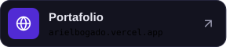</a><a href="https://www.linkedin.com/in/arielbogadogimenez">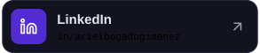</a>
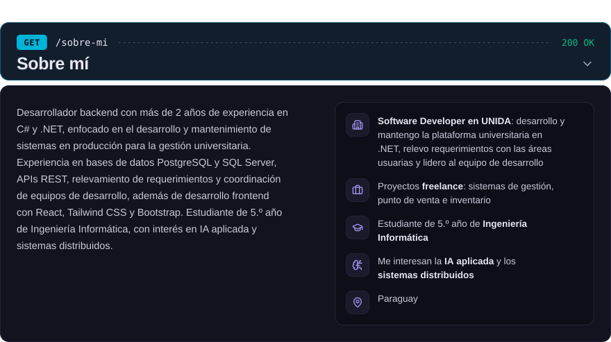
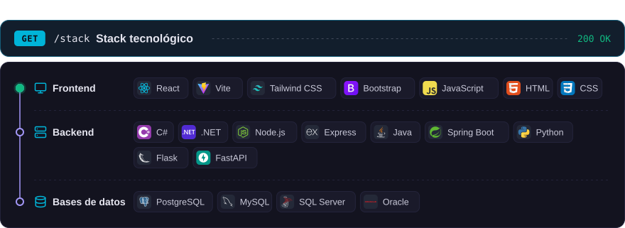
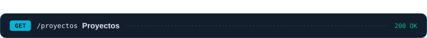
<a href="https://github.com/ArielBG1/Cyclo">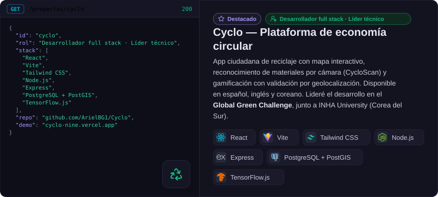</a>
<a href="https://cyclo-nine.vercel.app">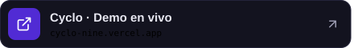</a><a href="https://github.com/ArielBG1/Cyclo">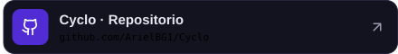</a>
<a href="https://github.com/ArielBG1/DespensaAPP">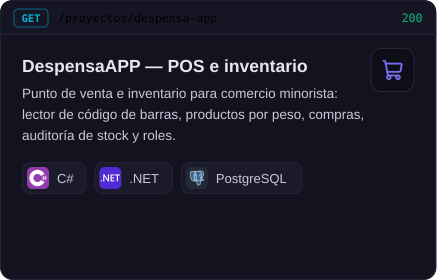</a><a href="https://github.com/ArielBG1/sistema_marcacion_docente">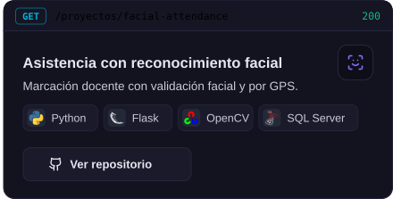</a>
<a href="https://github.com/ArielBG1/soporte_ticket">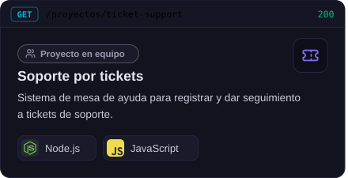</a><a href="https://github.com/ArielBG1/Torotech-LandingPage">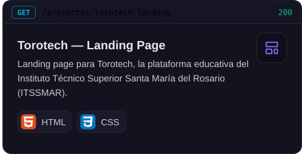</a>
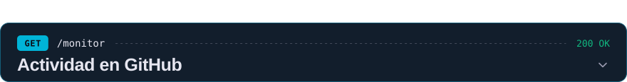

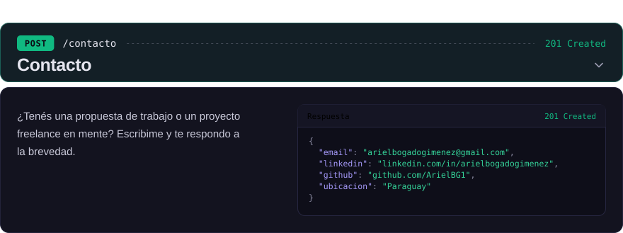

 whoami → ariel-bogado" />

